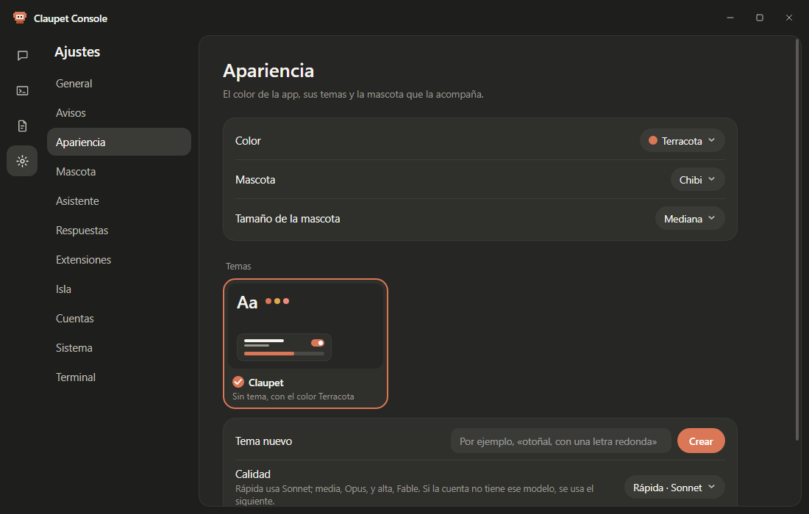

# ⚙️ Settings

**English** · [Español](../es/ajustes.md)

Every section of Settings and what each option does, in the order they appear.

**On this page:** [Where they are](#where-to-find-settings) · [General](#general) · [Alerts](#alerts) ·
[Appearance](#appearance) · [Pet](#pet) · [Assistant](#assistant) · [Answers](#answers) ·
[Extensions](#extensions) · [Island](#island) · [Accounts](#accounts) · [System](#system) ·
[Terminal](#terminal)

## Where to find settings

| Place | How to open it | What's in it |
|---|---|---|
| **Quick settings** | The gear at the bottom of the icon's window, or **Settings…** in its menu. | The everyday ones, in five tabs: Alerts, Appearance, Assistant, Island and System. |
| **Claupet Console** | **Settings** on the rail, or **All settings › Open** at the bottom of quick settings. | Everything, in sections. |

  

In the tables, 🪟 marks what's only in Claupet Console. Options your system doesn't have yet don't appear; a
section left empty says "Not available on this system yet."

## General

The language, how Claupet starts and its shortcuts.

| Option | What it does |
|---|---|
| **Language** | Español or English. Changing it restarts Claupet. It also changes the language of the microphone and the voice. |
| **Start with Windows** / **Start at login** | Opens Claupet when you turn on your computer. |
| **Shortcuts › In the Start menu** 🪟 | *Windows.* A shortcut that opens Claupet Console (on by default). |
| **Shortcuts › On the desktop** 🪟 | *Windows.* The same, on the desktop. |

## Alerts

How Claupet lets you know when a session finishes or needs something.

| Option | What it does |
|---|---|
| **Notifications** | Shows notifications (see [Notifications and the island](isla.md#notifications)). |
| **Sound** | Notifications play a sound. |
| **Sound style** | Classic, Giggles, Chibi, Dokki, Gemma or Ciel. |
| **Show a sample notification** | Shows one, with its sound. |
| **Open sounds folder** | To put your own sounds in `propios`. |

## Appearance

The app's color, your themes and the pet that keeps you company.

| Option | What it does |
|---|---|
| **Color** | Terracotta, Ocean, Forest, Lavender, Rose or Graphite. Picking one removes your own theme. |
| **Pet** | Classic, Chibi, Dokki, Gemma or Ciel; or just a refresh animation: Asterisk, Dots or None. |
| **Pet size** | Small, Medium, Normal or Large. |
| **Themes** 🪟 | The cards for your own themes. Tapping one selects it; its **⋯** menu exports or deletes it. |
| **New theme** 🪟 | Describe a theme and press **Create**: Claude designs it. |
| **Quality** 🪟 | Fast (Sonnet), Medium (Opus) or High (Fable). If the account doesn't have that model, it uses the next one. |
| **Import a theme** 🪟 | Brings in an exported theme (`.json`). |

More details in [The pets](mascotas.md#colors-and-themes).

## Pet

What the pet does on the desktop. These rows appear when **Desktop pet** is on.

| Option | What it does |
|---|---|
| **Desktop pet** | The pet lives on top of your windows. |
| **On every desktop** 🪟 | Follows you when you switch virtual desktops (Spaces on macOS). |
| **Flow gestures (what the session is doing)** 🪟 | Shows each step: reading, searching, typing, building. Off, it dances while working. |
| **Dance to music** 🪟 | *Windows.* Bobs its head and dances when something is playing. |
| **Notification gesture** 🪟 | Repeats each notification's gesture. |
| **Wave when appearing** 🪟 | Waves when it appears. |
| **Get angry at too many clicks** 🪟 | Pouts, crosses its arms and fumes after lots of clicks. |
| **Sleep with no sessions** 🪟 | Sleeps when there are no sessions. |
| **Talk (notifications in a bubble)** 🪟 | Tells you each notification its own way. |
| **Other agents › One pet per agent** 🪟 | A pet for Codex, Gemini or Copilot, next to Claude Code's. |
| **…'s pet** 🪟 | Each agent's character. |

## Assistant

The chat with the pet, the voice and the keys.

| Option | What it does |
|---|---|
| **Chat with the pet** | A click on the pet opens its bubble to chat. |
| **Pet model** | Who answers in the bubble: Automatic, "Same as your sessions", Haiku (default), Sonnet, Opus, Fable or the local model. |
| **Answering account** 🪟 | Which Claude Code account answers. |
| **Task folder** 🪟 | Where sessions open for the tasks the assistant hands to Claude Code. |
| **Analyze files you drop on it** 🪟 | Summarizes files you drop on the pet. |
| **Permissions** 🪟 | One switch per capability (screenshots, calendar, notes, reminders, windows, computer, brightness, status, clipboard, folders). Off: it asks the first time. |
| **Microphone** | Talk to it with your voice. Downloads the Whisper model the first time. |
| **Push-to-talk key** 🪟 | Right Ctrl (default), Right Alt, Right Shift or another one you record. |
| **Read answers aloud** | Answers are spoken. |
| **Voice** 🪟 | Female or Male (Claupet's voice) or the system one. |
| **Chat shortcut** 🪟 | *Windows.* Ctrl+Alt+Space, or another combination you record. |
| **Copilot key** 🪟 | *Windows.* The Copilot key opens the chat or, with the microphone on, listens. |
| **Keyboard shortcuts › View…** 🪟 | *Windows.* The list of shortcuts, and whether another app is using any of them. |

More details in [Assistant and voice](asistente-y-voz.md).

## Answers

🪟 *Claupet Console only.* Who answers each question: no AI, the local model or the cloud.

| Option | What it does |
|---|---|
| **No AI** | Always on, 0 tokens. |
| **Local model** | *Windows.* Qwen3.5 0.8B, 2B or 4B; the row below downloads it, shows the progress or deletes it. |
| **Graphics card** | *Windows.* Automatic, Always or Never. |
| **Free the memory after** | *Windows.* Minutes without use before the local model frees the memory. |
| **Cloud** | The cloud model to use. |
| **Mode** | Default, Token saver, Only on this computer or Custom (with a row per type of question). |
| **Pass to the next engine** | How far a question goes when it isn't understood. |
| **Show who answered** | A chip below each answer. |
| **My city** | For the weather: by IP, the Windows location or a city you type. |
| **This week, without the cloud** | How many answers didn't spend tokens. |

## Extensions

🪟 *Claupet Console and Windows only.* Installed extensions, **Install from file…** and the local API.
[Extensions](extensiones.md) explains it.

## Island

The island at the top edge: the chat, permissions and the weekly recap.

| Option | What it does |
|---|---|
| **Island at the top edge** | Turns on the island. |
| **Island model** | Who answers in the island chat ("Same as your sessions", by default). |
| **Open on hover** | Opens with the cursor over it; off, with a click. |
| **Visible while something is working** 🪟 | Stays compact and in view while any session is working. |
| **Island permissions and questions › Set up…** 🪟 | Adds the hook to answer Claude Code's permissions on the island. |
| **Weekly recap on Mondays** 🪟 | Every Monday, how your week went. |
| **This week's recap › View now** 🪟 | Shows it right away. |

## Accounts

🪟 *Claupet Console only.* The Claude Code accounts and other agents Claupet follows.

| Option | What it does |
|---|---|
| **Claude Code** | Each account, and whether its memory is its own or shared with another. |
| **Add account…** | Adds another config folder (see [Getting started](primeros-pasos.md#your-claude-code-accounts)). |
| **Other agents** | A switch for each agent found (Codex CLI, Gemini CLI, GitHub Copilot CLI): whether it's followed in Usage and Activity. |

## System

The permission hook, diagnostics and new versions.

| Option | What it does |
|---|---|
| **Permission notifications (hook) › Set up…** 🪟 | Opens the setup assistant. |
| **If something isn't working › Copy diagnostics** | Copies a summary, without emails or tokens, so you can ask for help. |
| **Remove hook and Windows startup › Remove…** 🪟 | Removes the Claude Code hooks and starting with the system. |
| **Installed version** 🪟 | The version that's running. |
| **Check for updates** 🪟 | Once a day, on GitHub. Nothing is installed without asking you. |
| **Claupet X is available** | Shows up when there's a new version: **Download and install…**, the progress or **Restart now**. |

## Terminal

🪟 *Claupet Console only.* How Claupet Terminal sessions look: font, size, line spacing, text color,
background, session list, animations and linked projects.
[Claupet Terminal](terminal.md#settings--terminal) explains it.

---

[← Assistant and voice](asistente-y-voz.md) · [Index](README.md) · [Extensions →](extensiones.md)
