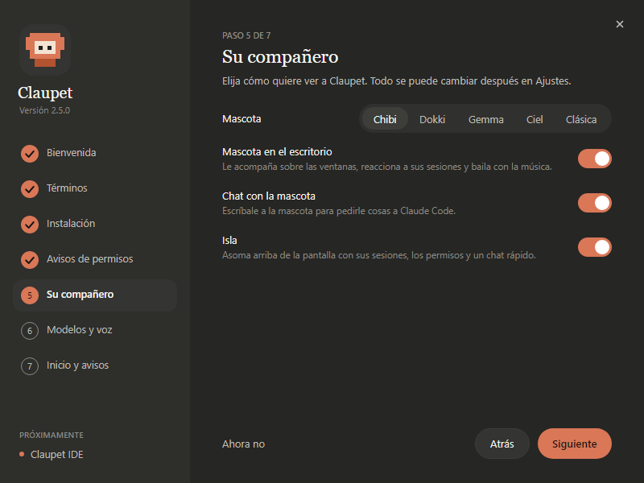
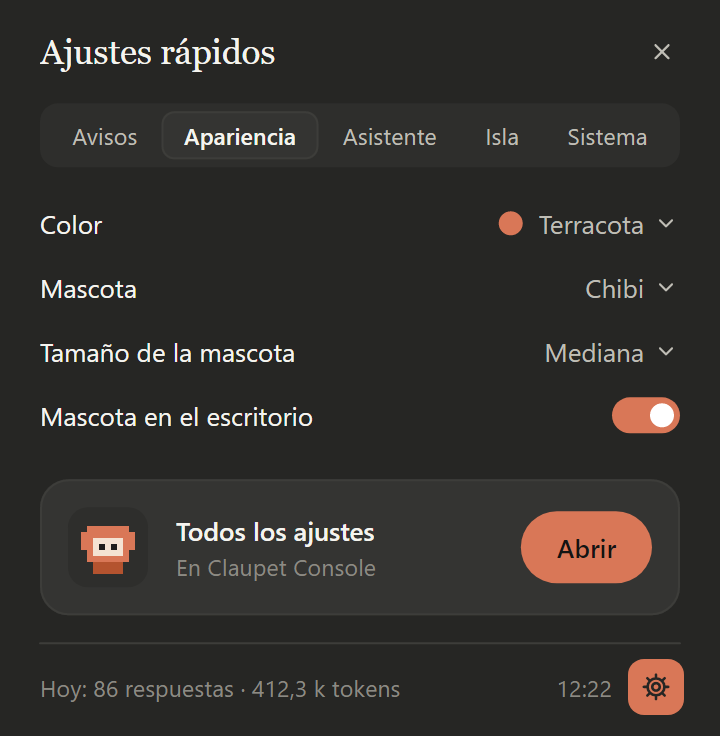

# 🚀 Getting started

**English** · [Español](../es/primeros-pasos.md)

The setup assistant, the icon by the clock and your Claude Code accounts: what's worth knowing on day
one.

**On this page:** [The setup assistant](#the-setup-assistant) ·
[The icon and its window](#the-icon-and-its-window) · [Your Claude Code accounts](#your-claude-code-accounts)

## The setup assistant

The first time you open Claupet, **Set up Claupet** appears: a step-by-step assistant. Nothing changes
until you press **Apply**, on the last step.

  

| Step | What it does |
|---|---|
| **Welcome** | Picks the language (Spanish or English) and shows what's new. |
| **Terms** | Asks you to accept the terms and conditions. If you don't, Claupet closes. |
| **Installation** | *Windows only.* The folder Claupet installs into, and whether you want a desktop shortcut (the Start menu one is always created). [Install Claupet](instalar.md#install-on-windows) explains it. |
| **Permission notifications** | Adds a hook to the `settings.json` in each Claude Code folder so you're told when a session asks for permission. It saves a backup before changing it. |
| **Your companion** | The pet, whether it lives on the desktop, the chat with the pet and the island at the top edge. |
| **Models and voice** | Talking to it with the microphone, reading answers aloud, installing extensions and the local model (depending on the system). |
| **Startup and alerts** | Starting Claupet with your computer, and notifications. **Apply** is here. |

> [!TIP]
> Want to see it again? In Claupet Console, **Settings › System › Permission notifications (hook) ›
> Set up…** opens the assistant again.

> [!NOTE]
> The voice models and the local model are downloaded separately, and only if you turn them on: the
> microphone's (Whisper, about 488 MB), Claupet's voice (about 400 MB) and the local model (533 MB to
> 2.7 GB). They download once, in the background.

## The icon and its window

Claupet lives in the Windows or Linux tray, or in the macOS menu bar.

  

- **The icon** shows how much of the selected account's 5-hour session is used. While refreshing, the
  pet you chose animates it.
- **One click** opens or closes the window, with three views at the top: **Usage**, **Activity** and
  **History** (see [Usage, activity and history](uso.md)).
- **The gear** at the bottom opens **Quick settings**, in five tabs: Alerts, Appearance, Assistant,
  Island and System. At the end, **All settings › Open** takes you to Claupet Console.
- **The icon's menu** (right-click) is short:

| Option | What it does |
|---|---|
| **Open** | Shows the window. |
| **Refresh** | Checks usage again right now. If the account's session has expired, it renews it. |
| **New session…** | Opens Claude Code in a terminal, with the account, folder and model you choose (see [Usage](uso.md#open-a-new-session)). |
| **Claupet Console** | Opens the big window (see [Claupet Console](console.md)). |
| **Settings…** | Opens quick settings. |
| **Quit** | Closes Claupet. |

## Your Claude Code accounts

Each Claude Code account is a config folder: `~/.claude` or whichever one you set with
`CLAUDE_CONFIG_DIR`. Claupet finds the signed-in `~/.claude*` folders on its own.

### How to add an account

1. Open the icon's window, in the **Usage** view, and press **+** (or, in Claupet Console,
   **Settings › Accounts › Add account…**).
2. Choose that account's config folder (its `CLAUDE_CONFIG_DIR`).
3. If it doesn't have its own memory yet and there's already another account, choose how its memory
   works:
   - **Shared:** its `projects` folder (the conversations and each project's memory) is linked to the
     chosen account's. `CLAUDE.md`, skills, agents, settings and credentials stay its own.
   - **Separate:** each account keeps its own.

> [!NOTE]
> An account whose `projects` folder already has content isn't linked, so nothing gets lost.
> **Settings › Accounts** says for each one whether its memory is its own or shared.

### How to rename or remove an account

Right-click the account's button in the **Usage** view: **Rename**, **Open folder** or **Remove**.
Removing it from Claupet doesn't touch anything in Claude Code.

> [!IMPORTANT]
> Claupet doesn't store passwords or touch Claude Code's credentials: it only reads them. If an account's
> access expires, Claupet asks Claude Code to renew it with a minimal request (with Haiku and no tools).

---

[← Install Claupet](instalar.md) · [Index](README.md) · [Usage, activity and history →](uso.md)
