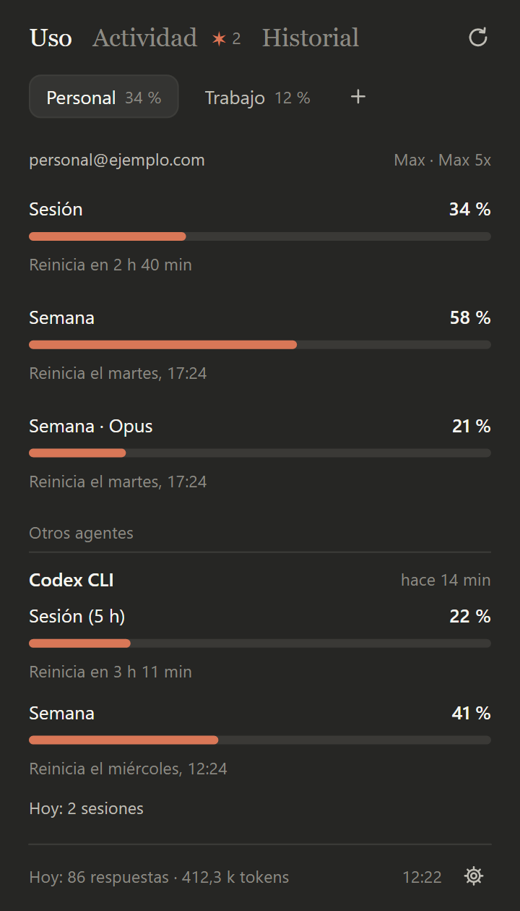
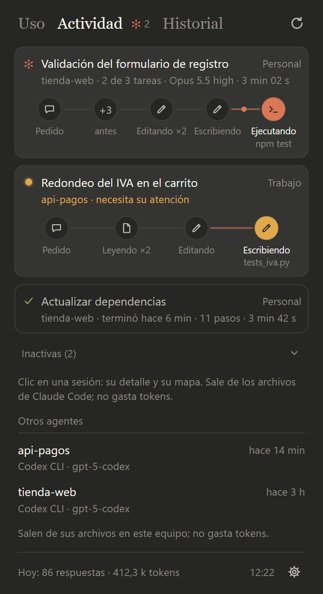
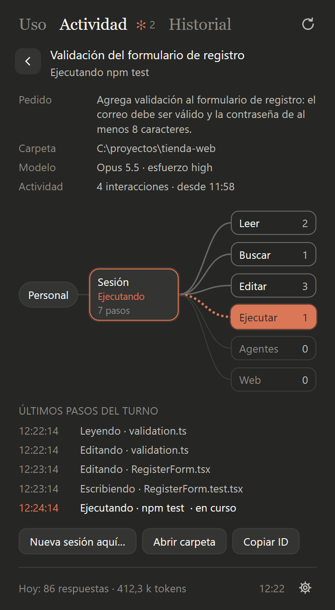
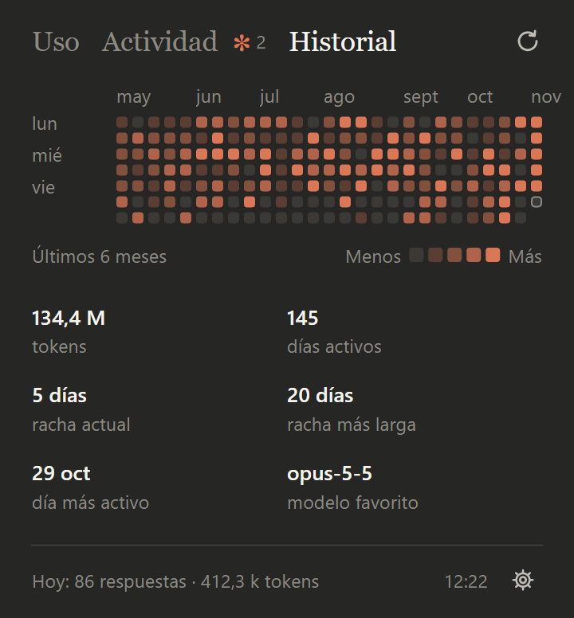

# 📊 Usage, activity and history

**English** · [Español](../es/uso.md)

How much each account has left, what your sessions are doing right now and how you've used Claude Code
over the last six months: the three views in the icon's window.

**On this page:** [Usage](#usage) · [Other agents](#other-agents-codex-gemini-and-copilot) ·
[Activity](#activity) · [History](#history) · [Open a new session](#open-a-new-session)

> [!NOTE]
> Everything on this page comes from files on your computer and from the same request `/usage` makes in
> Claude Code. Looking at it **costs no tokens**.

## Usage

  

There's a button per account at the top. For the selected one you see:

| Row | What it shows |
|---|---|
| **Session** | Usage of the 5-hour window, with its bar and when it resets ("Resets in 2 h 10 min"). |
| **Week** | The weekly limit, with the day and time it resets. |
| **Week · model** | A model's weekly limit, if your plan has one. |
| **Footer** | Today's tokens on this computer and the time of the data you're seeing. |

Claupet refreshes on its own every 5 minutes. To do it now, use **Refresh** in the icon's menu.

> [!TIP]
> The number on the icon is the selected account's 5-hour session percentage. It tells you how much is
> left without opening anything.

**If you see "Loading…" or data from a while ago.** Anthropic limits these requests heavily. Claupet asks
at most once a minute per account and, if it's told to wait, keeps showing the last good data (the footer
says what time it's from) and tries again later.

**If you see "Session expired: refresh to renew it."** Press **Refresh**: Claupet asks Claude Code to renew
that account's access and checks again.

## Other agents: Codex, Gemini and Copilot

If you also use Codex CLI, Gemini CLI or GitHub Copilot CLI on this computer, Claupet finds them on its own
and shows them below the account, under **Other agents**:

| Agent | What you see in Usage |
|---|---|
| **Codex CLI** | Its 5-hour and weekly limits, with their percentage, once it has answered at least once. |
| **Gemini CLI** | Today's responses and tokens. Gemini CLI doesn't record how much of its quota is left, so there's no percentage. |
| **GitHub Copilot CLI** | Today's activity (its format isn't documented, so you see less). |

Only the ones that did something today or have a limit still running show up. Choose which ones to follow
in Claupet Console's **Settings › Accounts**. Claupet only reads their files: it doesn't use their accounts
or spend tokens.

> [!NOTE]
> Since June 18, 2026, Gemini's free and Google One accounts use Antigravity CLI, which Claupet can't read
> yet.

## Activity

  
  

Every Claude Code session open on your computer, with its status and its live lane of steps ("Reading ×3",
"Thinking…", the subagent at work):

| Status | Sign |
|---|---|
| **Working** | An animated asterisk and its steps. With a task list, "3 of 5 tasks". |
| **Waiting for your answer** | A pulsing amber dot: it asked you a question. |
| **Failed** | A red cross and the error text. |
| **Done** | A green check and how long ago ("5 min ago"). |
| **Idle** | A gray dot. Those idle for more than 30 minutes are folded away at the end. |

- **Click a session:** its details, with the last prompt, the folder, the model, a map of the tools it used
  this turn and the latest steps with their times.
- **Right-click:** **New session in this folder…**, **Open project folder** or **Copy session ID**.

Codex, Gemini and Copilot sessions from the last 24 hours show up too, with their folder and model when
known.

## History

  

A calendar with one square per day for the last 6 months, across all your accounts. The color deepens with
the day's tokens; hover to see the number. Below it: tokens for the period, active days, current and longest
streak, your busiest day and your favorite model.

> [!NOTE]
> Claude Code deletes its logs after 30 days. So you don't lose your history, Claupet keeps a daily summary,
> numbers only, in its own folder.

## Open a new session

From **New session…** in the icon's menu (or by right-clicking a session in Activity):

1. Choose the **Account**, the **Folder** (with **Browse…**), the **Model**, the **Effort** and the
   **Advisor**. "Account default" keeps whatever the account has.
2. Press **Open**.
3. Claude Code opens in a terminal: Windows Terminal (or PowerShell) on Windows, Terminal on macOS and the
   first one it finds on Linux (gnome-terminal, konsole, kitty…).

What you choose applies only to that session: it doesn't change the account's settings.

> [!TIP]
> Prefer to see the session in blocks, with its permissions and changes in view? Open it in
> [Claupet Terminal](terminal.md).

---

[← Getting started](primeros-pasos.md) · [Index](README.md) · [Claupet Console →](console.md)
