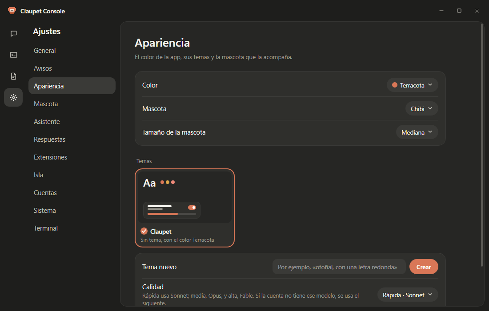

# ⚙️ Ajustes

**Español** · [English](../en/ajustes.md)

Cada sección de Ajustes y qué hace cada opción, en el orden en que aparecen.

**En esta página:** [Dónde están](#dónde-están-los-ajustes) · [General](#general) · [Avisos](#avisos) ·
[Apariencia](#apariencia) · [Mascota](#mascota) · [Asistente](#asistente) · [Respuestas](#respuestas) ·
[Extensiones](#extensiones) · [Isla](#isla) · [Cuentas](#cuentas) · [Consumo](#consumo) · [Sistema](#sistema) ·
[Terminal](#terminal)

## Dónde están los ajustes

| Lugar | Cómo se abre | Qué trae |
|---|---|---|
| **Ajustes rápidos** | El engranaje del pie de la ventana del ícono, o **Ajustes…** en su menú. | Lo de todos los días, en cinco pestañas: Avisos, Apariencia, Asistente, Isla y Sistema. |
| **Claupet Console** | **Ajustes** en el riel, o **Todos los ajustes › Abrir** al pie de los rápidos. | Todo, en secciones. |

  

En las tablas, 🪟 marca lo que solo está en Claupet Console. Las opciones que su sistema todavía no tiene no
aparecen; una sección que queda vacía dice «Todavía no está disponible en este sistema.».

## General

El idioma, el inicio de Claupet y sus accesos directos.

| Opción | Qué hace |
|---|---|
| **Idioma** | Español o English. Al cambiarlo, Claupet se reinicia. Cambia también el idioma del micrófono y de la voz. |
| **Iniciar con Windows** / **Iniciar con el sistema** | Abre Claupet al encender el equipo. |
| **Accesos directos › En el menú Inicio** 🪟 | *Windows.* Un acceso que abre Claupet Console (encendido de entrada). |
| **Accesos directos › En el escritorio** 🪟 | *Windows.* Lo mismo, en el escritorio. |

## Avisos

Cómo le avisa Claupet cuando una sesión termina o necesita algo.

| Opción | Qué hace |
|---|---|
| **Notificaciones** | Muestra los avisos (ver [Avisos e isla](isla.md#los-avisos)). |
| **Sonido** | Los avisos suenan. |
| **Estilo de sonido** | Clásico, Risitas, Chibi, Dokki, Gemma o Ciel. |
| **Ver un aviso de ejemplo** | Muestra uno, con su sonido. |
| **Abrir carpeta de sonidos** | Para poner sus propios sonidos en `propios`. |

## Apariencia

El color de la app, sus temas y la mascota que la acompaña.

| Opción | Qué hace |
|---|---|
| **Color** | Terracota, Océano, Bosque, Lavanda, Rosa o Grafito. Elegir uno quita el tema propio. |
| **Mascota** | Clásica, Chibi, Dokki, Gemma o Ciel; o solo una animación al actualizar: Asterisco, Puntos o Ninguna. |
| **Tamaño de la mascota** | Pequeño, Mediano, Normal o Grande. |
| **Temas** 🪟 | Las tarjetas de sus temas propios. Tocar una la elige; su menú **⋯** la exporta o la elimina. |
| **Tema nuevo** 🪟 | Describa un tema y pulse **Crear**: Claude lo diseña. |
| **Calidad** 🪟 | Rápida (Sonnet), Media (Opus) o Alta (Fable). Si la cuenta no tiene ese modelo, usa el siguiente. |
| **Importar un tema** 🪟 | Trae un tema exportado (`.json`). |

Más detalles en [Las mascotas](mascotas.md#colores-y-temas).

## Mascota

Lo que hace la mascota en el escritorio. Las filas aparecen con **Mascota en el escritorio** encendida.

| Opción | Qué hace |
|---|---|
| **Mascota en el escritorio** | La mascota vive sobre sus ventanas. |
| **En todos los escritorios** 🪟 | Le sigue al cambiar de escritorio virtual (en macOS, de Espacio). |
| **Gestos del flujo (lo que hace la sesión)** 🪟 | Muestra cada paso: lee, busca, teclea, construye. Apagado, baila mientras trabaja. |
| **Bailar con música** 🪟 | *Windows.* Cabecea y baila cuando algo suena. |
| **Gesto de los avisos** 🪟 | Repite el gesto de cada aviso. |
| **Saludar al aparecer** 🪟 | Saluda al aparecer. |
| **Enojarse con muchos clics** 🪟 | Puchero, brazos cruzados y furia con muchos clics. |
| **Dormir sin sesiones** 🪟 | Duerme cuando no hay sesiones. |
| **Hablar (los avisos en una nubecita)** 🪟 | Le cuenta cada aviso a su manera. |
| **Otros agentes › Una mascota por cada agente** 🪟 | Una mascota para Codex, Gemini o Copilot, junto a la de Claude Code. |
| **Mascota de …** 🪟 | El personaje de cada agente. |

## Asistente

El chat con la mascota, la voz y las teclas.

| Opción | Qué hace |
|---|---|
| **Chat con la mascota** | Un clic en la mascota abre su nubecita para conversar. |
| **Modelo de la mascota** | Quién responde en la nubecita: Automático, «El de sus sesiones», Haiku (de entrada), Sonnet, Opus, Fable o el modelo local. |
| **Cuenta que responde** 🪟 | Con qué cuenta de Claude Code. |
| **Carpeta de las tareas** 🪟 | Dónde se abren las sesiones de las tareas que el asistente encarga a Claude Code. |
| **Analizar los archivos que le suelte** 🪟 | Resume los archivos que suelta sobre la mascota. |
| **Permisos** 🪟 | Un interruptor por capacidad (capturas, agendar, notas, recordatorios, ventanas, equipo, brillo, estado, portapapeles, carpetas). Apagado: se pregunta la primera vez. |
| **Micrófono** | Hablarle con la voz. Descarga el modelo Whisper la primera vez. |
| **Tecla para hablar** 🪟 | Ctrl derecho (de entrada), Alt derecho, Mayús derecha u otra grabada. |
| **Leer las respuestas en voz alta** | Las respuestas suenan. |
| **Voz** 🪟 | Femenina o Masculina (la voz de Claupet) o la del sistema. |
| **Atajo del chat** 🪟 | *Windows.* Ctrl+Alt+Espacio, u otra combinación grabada. |
| **Tecla Copilot** 🪟 | *Windows.* La tecla Copilot abre el chat o, con el micrófono, escucha. |
| **Atajos de teclado › Ver…** 🪟 | *Windows.* La lista de atajos y si alguno está en uso por otra app. |

Más detalles en [Asistente y voz](asistente-y-voz.md).

## Respuestas

🪟 *Solo en Claupet Console.* Quién responde cada pregunta: sin IA, el modelo local o la nube.

| Opción | Qué hace |
|---|---|
| **Sin IA** | Siempre activo, 0 tokens. |
| **Modelo local** | *Windows.* Qwen3.5 0.8B, 2B o 4B; la fila de abajo lo descarga, muestra el avance o lo borra. |
| **Tarjeta gráfica** | *Windows.* Automático, Siempre o Nunca. |
| **Liberar la memoria tras** | *Windows.* Los minutos sin uso tras los que el modelo local suelta la memoria. |
| **Nube** | El modelo de la nube que se usa. |
| **Modo** | Por defecto, Ahorro de tokens, Solo en este equipo o Personalizado (con una fila por tipo de pregunta). |
| **Pasar al siguiente motor** | Hasta dónde sigue una pregunta que no se entendió. |
| **Mostrar quién respondió** | Un chip debajo de cada respuesta. |
| **Mi ciudad** | Para el clima: por la IP, la ubicación de Windows o una ciudad escrita. |
| **Esta semana, sin la nube** | Cuántas respuestas no gastaron tokens. |

## Extensiones

🪟 *Solo en Claupet Console y en Windows.* El catálogo de las extensiones oficiales y las instaladas, instalar
desde un archivo `.claupet`, las ranuras y la API local. Lo explica [Extensiones](extensiones.md).

## Isla

La isla del borde de arriba: el chat, los permisos y el resumen de la semana.

| Opción | Qué hace |
|---|---|
| **Isla en el borde de arriba** | Enciende la isla. |
| **Modelo de la isla** | Quién responde en el chat de la isla («El de sus sesiones», de entrada). |
| **Abrir al pasar el cursor** | Se abre con el cursor encima; apagado, con un clic. |
| **A la vista mientras algo trabaja** 🪟 | Queda compacta a la vista mientras alguna sesión trabaja. |
| **Permisos y preguntas en la isla › Configurar…** 🪟 | Agrega el hook para responder los permisos de Claude Code en la isla. |
| **Resumen de la semana, los lunes** 🪟 | Cada lunes, cómo le fue la semana. |
| **El de esta semana › Ver ahora** 🪟 | Lo muestra ya. |

## Cuentas

🪟 *Solo en Claupet Console.* Las cuentas de Claude Code y los otros agentes que sigue Claupet.

| Opción | Qué hace |
|---|---|
| **Claude Code** | Cada cuenta y si su memoria es propia o compartida con otra. |
| **Agregar cuenta…** | Agrega otra carpeta de configuración (ver [Primeros pasos](primeros-pasos.md#sus-cuentas-de-claude-code)). |
| **Otros agentes** | Un interruptor por cada agente encontrado (Codex CLI, Gemini CLI, GitHub Copilot CLI): si se sigue en Uso y Actividad. |

## Consumo

🪟 Lo que gastaron todos los agentes en este equipo (Claude Code, Codex, Gemini CLI, OpenCode y Copilot CLI), por
modelo. Se lee de sus archivos: no usa sus cuentas ni gasta tokens. La primera vez lee los últimos 31 días (puede
tardar unos segundos); después, cada minuto, solo lo nuevo.

| Parte | Qué muestra |
|---|---|
| **Periodo** | Hoy (por hora), 7 días, 30 días o este mes (por día). Con más de una cuenta de Claude Code, también se elige la cuenta. |
| **Franja de arriba** | Los agentes (tocarlos los oculta o los vuelve a mostrar) y los totales: respuestas, tokens de salida, de entrada (con lo leído de caché), de razonamiento y el costo. |
| **Tendencia** | Áreas apiladas por agente o por modelo, de tokens de salida, de entrada o de respuestas. Al pasar el mouse se ve cada tramo. |
| **Por modelo** | Una fila por modelo con su agente y proveedor, respuestas, entrada, caché, salida, razonamiento, su tendencia y su parte de la salida. Se ordena tocando una columna. |
| **Reparto de la salida** | Una dona por modelo o por agente. |
| **Actividad por hora** | Las respuestas de los últimos 7 días, por día y hora. |
| **Límites** | Los que escriben Claude Code y Codex, con cuándo se reinician. |
| **Por proyecto** | El repositorio de cada sesión (los worktrees cuentan en el suyo). |
| **Exportar CSV** | La tabla por modelo del periodo, para una hoja de cálculo. |

El costo aparece solo si el agente lo escribe: OpenCode, en dólares; Copilot CLI, en solicitudes premium. Claude
Code, Codex y Gemini CLI no lo escriben, y Claupet no lo estima. Solo cuentan los agentes que se siguen en
[Cuentas](#cuentas).

## Sistema

El hook de permisos, el diagnóstico y las versiones nuevas.

| Opción | Qué hace |
|---|---|
| **Avisos de permisos (hook) › Configurar…** 🪟 | Abre el asistente de configuración. |
| **Si algo no funciona › Copiar diagnóstico** | Copia un resumen, sin correos ni tokens, para pedir ayuda. |
| **Quitar hook e inicio con Windows › Quitar…** 🪟 | Quita los hooks de Claude Code y el inicio con el sistema. |
| **Versión instalada** 🪟 | La versión que corre. |
| **Buscar actualizaciones** 🪟 | Una vez al día, en GitHub. Nada se instala sin preguntarle. |
| **Claupet X está disponible** | Aparece con una versión nueva: **Descargar e instalar…**, el avance o **Reiniciar ahora**. |

## Terminal

🪟 *Solo en Claupet Console.* Cómo se ven las sesiones de Claupet Terminal: letra, tamaño, interlineado,
color del texto, fondo, lista de sesiones, animaciones y los proyectos vinculados. Lo explica
[Claupet Terminal](terminal.md#ajustes--terminal).

---

[← Asistente y voz](asistente-y-voz.md) · [Índice](../README.md) · [Extensiones →](extensiones.md)
