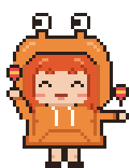
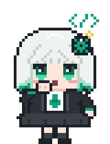

# 🐾 Las mascotas

**Español** · [English](../en/mascotas.md)

Chibi, Dokki, Gemma y Ciel viven en su escritorio y reaccionan a lo que hacen sus sesiones. Aquí verá cómo
elegirlas, qué significa cada gesto y cómo cambiar colores, temas y sonidos.

**En esta página:** [Elegir su mascota](#cómo-elegir-su-mascota) · [En el escritorio](#la-mascota-en-el-escritorio) ·
[Qué significa cada gesto](#qué-significa-cada-gesto) · [Una por agente](#una-mascota-por-cada-agente) ·
[Sonidos](#sonidos) · [Colores y temas](#colores-y-temas)

  

## Los personajes

<table>
  <tr>
    <td align="center" width="25%"></td>
    <td align="center" width="25%"></td>
    <td align="center" width="25%"></td>
    <td align="center" width="25%"></td>
  </tr>
  <tr>
    <td align="center"><b>Chibi</b> Claude</td>
    <td align="center"><b>Dokki</b> DeepSeek</td>
    <td align="center"><b>Gemma</b> Gemini</td>
    <td align="center"><b>Ciel</b> Codex</td>
  </tr>
  <tr>
    <td valign="top">Hoodie de cangrejo con ojitos sobre antenas. Construye una casita con el mazo y toca maracas cuando se renueva un límite.</td>
    <td valign="top">Sirvienta ballena, dulce y tranquila. Saluda con una reverencia, festeja con un chorrito y duerme soltando burbujas.</td>
    <td valign="top">Tsundere de coletas. Festeja… y enseguida disimula. Saluda de mala gana. ¡Hmph!</td>
    <td valign="top">Serena. Piensa con un <code>&lt;/&gt;</code> verde y festeja sin saltar, con el visto bueno.</td>
  </tr>
</table>

Cada una tiene sus gestos propios y su voz, y el asistente toma su personalidad cuando le habla. También está
la **Clásica**, la criaturita de un color que sigue al color de la app.

## Cómo elegir su mascota

1. Abra **Ajustes › Apariencia** (en los ajustes rápidos o en Claupet Console).
2. En **Mascota**, elija **Clásica**, **Chibi**, **Dokki**, **Gemma** o **Ciel**.
3. Si quiere, cambie el **Tamaño de la mascota**: Pequeño, Mediano, Normal o Grande.

La mascota elegida anima también el ícono mientras actualiza y aparece en los avisos.

> [!TIP]
> ¿Prefiere un ícono sin mascota? En la misma lista están **Asterisco** (el ✻ de Claude Code), **Puntos**
> (una ola que termina en sonrisa) y **Ninguna**. Son solo la animación al actualizar; los avisos llevan la
> Clásica.

## La mascota en el escritorio

Encienda **Ajustes › Mascota › Mascota en el escritorio** (se enciende sola al elegir un personaje).

- **Arrástrela** a donde quiera; no se sale de la pantalla y recuerda su lugar.
- **Clic derecho:** **Abrir Claupet** u **Ocultar del escritorio**.
- **Un clic:** la saluda. Muchos clics seguidos… mejor no.
- **Suéltele un archivo** encima y se lo lleva en una caja a la isla para resumirlo (ver
  [Avisos e isla](isla.md#archivos-en-caja)).

Con **Hablar (los avisos en una nubecita)**, le cuenta cada aviso a su manera en una nubecita sobre su cabeza.
Un clic en la nubecita abre lo mismo que el aviso.

## Qué significa cada gesto

| Gesto | Cuándo |
|---|---|
| Lee un libro | La sesión lee archivos. |
| Mira por la lupa | Busca en el proyecto. |
| Escribe en la libreta | Edita o crea archivos. |
| Teclea en la laptop | Ejecuta comandos. |
| Gira el globo | Busca o lee en la web. |
| Aparece un ayudante con un «puf» | Delega en un subagente. |
| Una nube con tres puntos | Piensa el siguiente paso. |
| Construye una casita | Usa otra herramienta, o lleva rato pensando. |
| Festeja | Terminó. |
| Manito en la boca | Espera su respuesta: una pregunta o un permiso. |
| Duerme | No hay sesiones. |
| Chachachá con maracas | Se renovó un límite (sesión o semana). |
| Mareada | Algo falló, o el uso está al límite. |
| Saluda | Al aparecer y con un clic. |
| Puchero, brazos cruzados, furia | 3, 6 y 9 clics seguidos. Se le pasa a los pocos segundos. |

Con varias sesiones, muestra lo más importante: primero una pregunta o un permiso, después lo que cambia
cosas (editar, ejecutar) y después lo que consulta.

> [!NOTE]
> Con música sonando en Windows (Spotify, YouTube en el navegador…), cabecea al compás y, sin trabajo, baila.
> Solo mira si algo suena, no qué suena.

### Cómo apagar un comportamiento

En Claupet Console, **Ajustes › Mascota** tiene un interruptor por cada uno, todos encendidos de entrada:

| Interruptor | Si lo apaga |
|---|---|
| **En todos los escritorios** | Deja de seguirle al cambiar de escritorio virtual (en macOS, de Espacio). |
| **Gestos del flujo (lo que hace la sesión)** | Baila mientras trabaja, en vez de mostrar cada paso. |
| **Bailar con música** *(Windows)* | No reacciona a la música. |
| **Gesto de los avisos** | No repite el gesto de cada aviso. |
| **Saludar al aparecer** | Aparece sin saludar. |
| **Enojarse con muchos clics** | Siempre saluda. |
| **Dormir sin sesiones** | Se queda quieta. |

## Una mascota por cada agente

¿Sigue también a Codex, Gemini o Copilot? En **Ajustes › Mascota › Otros agentes**, encienda **Una mascota por
cada agente**: cada uno tiene la suya junto a la de Claude Code.

- Elija el personaje de cada uno en **Mascota de …**. Cualquier personaje sirve para cualquier agente.
- Teclea mientras ese agente trabaja, queda quieta si trabajó hace poco y después duerme.
- **Ocultar del escritorio**, en su clic derecho, deja a ese agente sin mascota.

## Sonidos

En **Ajustes › Avisos**:

- **Estilo de sonido:** Clásico, Risitas, Chibi (un «¡oi!» y un «¡uwaaa!» si algo falla), Dokki, Gemma o
  Ciel. Cada personaje tiene su timbre.
- **Ver un aviso de ejemplo** lo muestra y lo hace sonar.
- **Abrir carpeta de sonidos** abre la carpeta `sonidos`.

> [!TIP]
> **Sus propios sonidos.** Dentro de `sonidos`, en la carpeta `propios`, ponga un `.wav` o `.mp3` llamado
> `terminado`, `pregunta`, `permiso`, `fallo`, `uso` o `aviso`: suena en lugar del estilo elegido.

## Colores y temas

**Color.** En **Ajustes › Apariencia › Color**, elija una paleta: Terracota (la de siempre), Océano,
Bosque, Lavanda, Rosa o Grafito. Cambia el acento de barras, interruptores, enlaces, el ícono y la mascota
Clásica. El modo claro u oscuro sigue al de su sistema.

**Temas propios.** En Claupet Console, **Ajustes › Apariencia › Temas** muestra una tarjeta por tema, con su
vista previa. Para crear uno:

1. En **Tema nuevo**, describa lo que quiere: «un tema de playa con el fondo animado», «algo otoñal con una
   letra más redonda».
2. Elija la **Calidad**: Rápida (Sonnet), Media (Opus) o Alta (Fable).
3. Pulse **Crear** (o Intro). Mientras Claude lo diseña, su tarjeta brilla y se puede cancelar.
4. Al terminar, el tema queda elegido.

| Para… | Haga esto |
|---|---|
| Elegir un tema | Toque su tarjeta. La tarjeta **Claupet** es no usar ninguno. |
| Exportarlo o eliminarlo | Use el menú **⋯** de su tarjeta. |
| Traer uno | **Importar un tema › Elegir archivo…** (un `.json` exportado). |
| Volver a una paleta | Elija un **Color**: el tema se quita, pero sigue guardado en su tarjeta. |

> [!NOTE]
> Un tema puede traer su propia letra y un fondo animado en pixel art (playa, lluvia, nieve, estrellas,
> sakura…), que se ve en Claupet Console. Claupet corrige solo el contraste para que todo se siga leyendo
> bien. Crear un tema usa la cuenta del asistente, como cualquier mensaje.

---

[← Claupet Terminal](terminal.md) · [Índice](../README.md) · [Avisos e isla →](isla.md)
