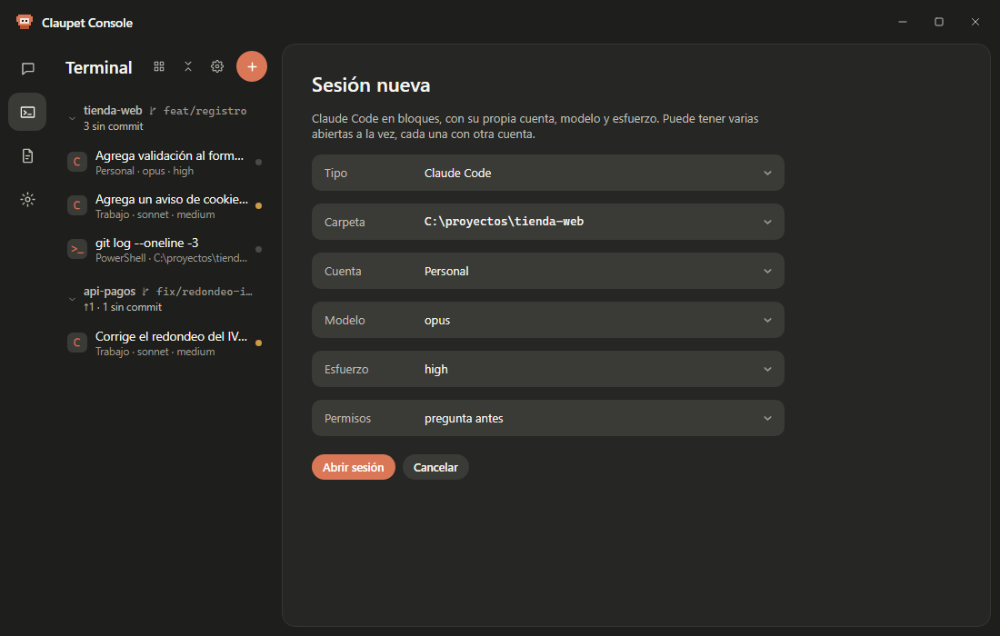

# ⌨️ Claupet Terminal

**Español** · [English](../en/terminal.md)

*Nuevo en la 2.5.0.* Trabaje con sus agentes en bloques, no en la pantalla de una terminal: el pedido, lo
que piensa, cada paso con su cambio, los permisos y el cierre del turno, todo a la vista.

**En esta página:** [Qué es](#qué-es) · [Abrir una sesión](#cómo-abrir-una-sesión) ·
[Los bloques](#los-bloques) · [Permisos y preguntas](#permisos-y-preguntas) ·
[Cambiar modelo, esfuerzo y permisos](#cómo-cambiar-el-modelo-el-esfuerzo-o-los-permisos-a-mitad-de-sesión) ·
[Otros agentes](#codex-gemini-cli-y-copilot-cli) · [Shells](#shells-en-bloques) ·
[Proyectos](#proyectos) · [Ramas, Cambios y Procesos](#el-panel-ramas-cambios-y-procesos) ·
[Ajustes › Terminal](#ajustes--terminal) · [Límites](#límites)

## Qué es

Claupet Terminal es una vista de [Claupet Console](console.md) (el botón **Terminal** del riel). Abre
agentes de código y shells en pestañas y muestra cada cosa en su bloque:

- **Claude Code**, **Codex**, **Gemini CLI** y **Copilot CLI**: los que estén instalados en su equipo.
- **Shells** *(Windows)*: PowerShell, Git Bash y bash de WSL, cada comando con su salida.
- **Varias sesiones a la vez**, agrupadas por proyecto, cada una con su cuenta, su modelo, su esfuerzo y
  sus permisos.

  

## Cómo abrir una sesión

1. En Claupet Console, pulse **Terminal** en el riel.
2. Pulse el botón **+** (**Sesión nueva**), arriba de la lista.
3. Complete el formulario:

   | Campo | Qué elige |
   |---|---|
   | **Carpeta** | Dónde trabaja el agente. La lista trae primero los proyectos vinculados y las carpetas recientes; **Elegir otra carpeta…** abre el selector. |
   | **Cuenta** | La cuenta de Claude Code de esta sesión (solo las que tienen la sesión iniciada). |
   | **Modelo** | `opus`, `sonnet`, `fable`, `haiku`, `opusplan` y las variantes `[1m]`, o «modelo por defecto». |
   | **Esfuerzo** | `low`, `medium`, `high`, `xhigh` o `max`, o «esfuerzo por defecto». |
   | **Permisos** | Cuánto pregunta antes de actuar (ver la tabla de abajo). |
   | **Tipo** | Claude Code, otro agente instalado o un shell. |

4. Pulse **Abrir sesión**.

  

Los modos de **Permisos** de Claude Code:

| Modo | Qué hace |
|---|---|
| **pregunta antes** | Pide permiso para lo que lo necesita (el de siempre). |
| **acepta ediciones** | Edita archivos sin preguntar; lo demás, pregunta. |
| **solo planifica** | Piensa y propone un plan, sin cambiar nada. |
| **automático** | Decide solo cuándo preguntar. |

> [!TIP]
> Puede tener varias sesiones abiertas a la vez, cada una con otra cuenta: por ejemplo, una con su cuenta
> personal y otra con la del trabajo, en el mismo proyecto.

### Cómo escribirle

Escriba en el cuadro de abajo, junto a **❯**. **Intro** envía y **Mayús+Intro** hace otra línea. Mientras
trabaja, **Interrumpir** (el cuadrado de arriba, o **Esc**) corta el turno.

Arriba de la sesión se ven el proyecto, su rama, el modelo y el esfuerzo, cuánto del contexto lleva
(«contexto 42 %») y el uso de la sesión de 5 horas de la cuenta («5 h 18 %»).

## Los bloques

| Bloque | Qué muestra |
|---|---|
| **El pedido** | Lo que usted escribió, con **❯** adelante. |
| **Pensando…** | Mientras piensa; al terminar, «Pensó · 1.234 tokens». |
| **La respuesta** | El texto, con los bloques de código aparte. |
| **Un paso** | Qué hizo («leyó», «editó», «creó», «ejecutó», «buscó», «delegó»…) y sobre qué, con las líneas sumadas y quitadas (`+12 −3`). Un clic abre su diff o lo que devolvió. |
| **La lista de tareas** | ☑ hecha, ◐ en curso, ☐ pendiente. |
| **Un permiso o una pregunta** | Con borde ámbar hasta que responda. |
| **El cierre del turno** | ✓ y cuánto tardó, los turnos y el costo si el agente lo informa; o ✕ con el error. |

## Permisos y preguntas

  

Cuando el agente necesita permiso, su bloque dice qué quiere hacer («Quiere ejecutar», «Quiere editar»…),
sobre qué, y el comienzo del comando o del texto. Elija:

- **Permitir**: solo esta vez.
- **Siempre aquí**: lo permite siempre en este proyecto (aparece cuando el agente lo ofrece).
- **Rechazar**.

  

Cuando le hace una pregunta, el bloque muestra cada pregunta («Pregunta 1 de 2») con sus opciones y su
explicación. Elija una (o varias, si dice «puede elegir varias»), o escriba la suya en **Otra
respuesta…**, y pulse **Responder**. Con una sola pregunta de una opción, el clic ya responde. **No
responder** la rechaza.

> [!TIP]
> **También en la isla.** Si la [isla](isla.md) está encendida, el permiso o la pregunta aparecen también
> allí, para responder sin volver a la Console. Vale la primera respuesta: el bloque dice después
> «Permitido en la isla» o «Respondido en la isla».

En la lista de la izquierda, una pestaña que espera permiso lleva el punto en ámbar.

## Cómo cambiar el modelo, el esfuerzo o los permisos a mitad de sesión

Debajo del cuadro para escribir hay unos chips: la cuenta, el modelo, el esfuerzo y los permisos.

1. Toque el chip que quiere cambiar.
2. Elija otro valor de la lista.
3. Vale desde el turno siguiente.

La cuenta no se cambia en una sesión abierta: para otra cuenta, abra otra sesión.

## Codex, Gemini CLI y Copilot CLI

Si están instalados (y en el `PATH`), aparecen en **Tipo** al abrir una sesión. Se ven en bloques igual que
Claude Code, con sus permisos aquí y en la isla.

- El modelo, el esfuerzo y los permisos se eligen **dentro de la sesión**, con los chips, entre lo que el
  agente dice tener al abrirse.
- La marca de la pestaña dice qué es: **C** Claude Code, **X** Codex, **G** Gemini CLI, **P** Copilot CLI y
  **>_** un shell.

### Cómo iniciar sesión en los otros agentes

Cada agente tiene que tener su sesión iniciada. Si no la tiene, su sesión lo avisa con el comando que hace
falta. Hágalo una vez en una terminal cualquiera y vuelva a escribir en la sesión:

| Agente | Qué ejecutar |
|---|---|
| **Gemini CLI** | `gemini` (y siga los pasos para iniciar sesión) |
| **Copilot CLI** | `copilot login` |
| **Codex** | `codex login`, o inicie sesión en la extensión de Codex de su editor (VS Code, Cursor o Windsurf): si `codex` no está en el PATH, Claupet usa el que trae esa extensión |

> [!NOTE]
> Si un agente no aparece o dice «No encontré … ¿Está instalado y en el PATH?», instálelo y compruebe que
> se abre escribiendo su nombre en una terminal.

## Shells en bloques

*Solo en Windows 10 (1809) o más nuevo.* En **Tipo**, elija **PowerShell**, **Git Bash** o **bash (WSL)**:
Claupet ofrece los que encuentra en su equipo.

  

Cada comando queda en su bloque, con su salida, cómo terminó («Terminó bien (código 0)» o «Terminó con el
código 1») y cuánto tardó.

| Tecla | Qué hace |
|---|---|
| **Intro** | Ejecuta el comando. |
| **↑** / **↓** | Recorren los comandos anteriores. |
| **Ctrl+C** | Interrumpe el que corre (sin nada corriendo, borra lo escrito). |

- Mientras un comando corre, lo que escriba le llega a él (por ejemplo, para responder «¿Continuar? [S/N]»).
  Con el cuadro vacío, las flechas, **Tab**, **Intro** y **Esc** le llegan directo: así se elige una opción
  de una pregunta, como la de confianza de `claude`.
- Al pasar el cursor sobre un bloque aparecen los íconos de **Copiar** y **Repetir**.

### Programas de pantalla completa

Los programas que usan toda la pantalla (`vim`, `nano`, `less`, el paginador de `git log`, `claude`, `htop`)
se ven en la sesión entera, con sus colores y del tamaño del panel, como en cualquier terminal. Las teclas, el
texto, la rueda del mouse y **Ctrl+V** (pegar) les llegan directo. Al salir del programa vuelven los bloques.
- Un bloque muestra las primeras 30 líneas; **Ver más líneas** abre el resto. Se guardan las últimas 400.

## Proyectos

La lista de la izquierda agrupa las pestañas por proyecto (la carpeta). Un proyecto se vincula solo al abrir
una sesión en su carpeta.

- **Desplegado:** su rama y cómo está el repositorio (por ejemplo, «↑2 · 3 sin commit»), con sus
  pestañas debajo.
- **Plegado:** cuántas pestañas tiene y un punto por cada una.
- **Plegar todos los proyectos** / **Desplegar todos los proyectos**: el botón de arriba de la lista.
- **El menú «⋯»** de cada proyecto: **Sesión nueva aquí**, **Abrir la carpeta** y **Desvincular**.

> [!NOTE]
> Desvincular solo quita el proyecto de la lista: no borra la carpeta. Si tenía sesiones abiertas, las
> cierra.

El borde de la lista se arrastra para ensancharla, y el botón de arriba la cambia a **Solo íconos**.

## El panel Ramas, Cambios y Procesos

El botón **Ramas, cambios y procesos**, arriba de la sesión, abre un panel a la derecha con tres pestañas:

| Pestaña | Qué muestra |
|---|---|
| **Ramas** | Las ramas del repositorio, qué agente trabaja en cada una, si tiene worktree, lo que falta por commit y si su remota ya no está. Toque la rama actual o una con worktree para abrir ahí una sesión. |
| **Cambios** | Los archivos sin commit con sus líneas sumadas y quitadas. Toque uno para ver su diff. |
| **Procesos** | Lo que abrió cada sesión, con su memoria. **Detener** corta el proceso y lo que abrió. Se actualiza cada 3 segundos. |

  
  

> [!NOTE]
> Ramas y Cambios necesitan que la carpeta sea un repositorio de git y que git esté instalado.

## Ajustes › Terminal

Cómo se ven las sesiones. Se abre desde **Ajustes › Terminal** en la Console. Se guarda en este equipo y vale para todas las pestañas.

  

| Opción | Valores |
|---|---|
| **Letra** | «La de siempre» o una de ancho fijo instalada (Cascadia Mono, Consolas, JetBrains Mono, Fira Code…). |
| **Tamaño** | De 11,5 a 18 pt. |
| **Interlineado** | Junto, Normal o Amplio. |
| **Color del texto** | El del tema, Ámbar, Verde o Hielo. |
| **Fondo** | El del tema, Más profundo o Negro, de consola. |
| **Lista de sesiones** | Con descripción o Solo íconos. |
| **Animaciones** | «Pensando», el giro de los pasos y los bloques que aparecen. Apagadas, gasta menos. |

Debajo, una **Vista previa** y los **Proyectos vinculados**, cada uno con **Desvincular**. **Lo de
siempre** vuelve a los valores de entrada.

## Límites

- **Cerrar Claupet Console cierra todas las sesiones** de la Terminal: ningún agente queda corriendo.
- Los shells en bloques todavía no existen en macOS ni en Linux.
- Los otros agentes tienen que estar instalados y con la sesión iniciada.

---

[← Claupet Console](console.md) · [Índice](../README.md) · [Las mascotas →](mascotas.md)
